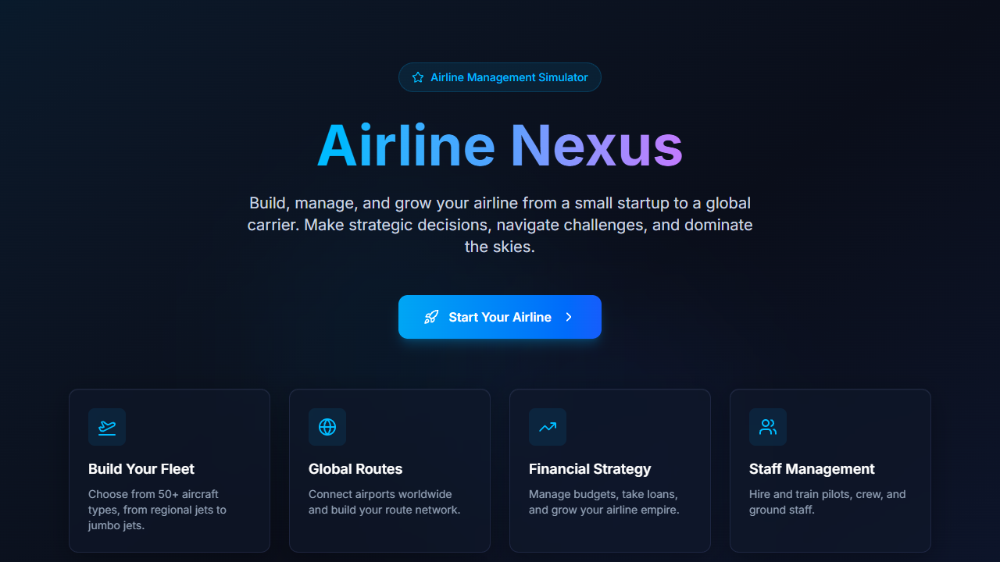
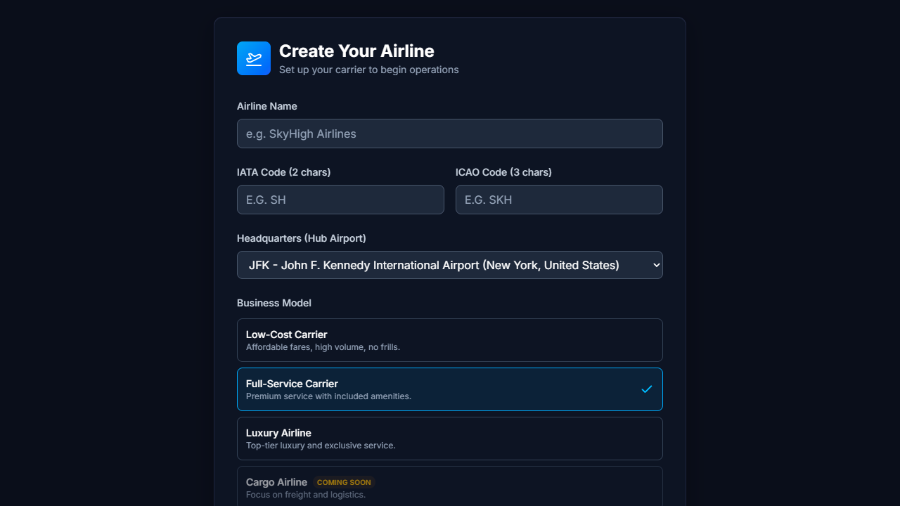
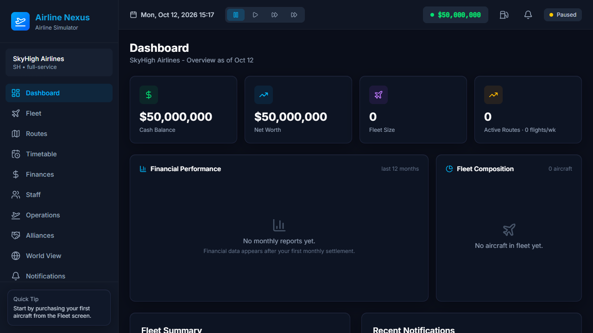
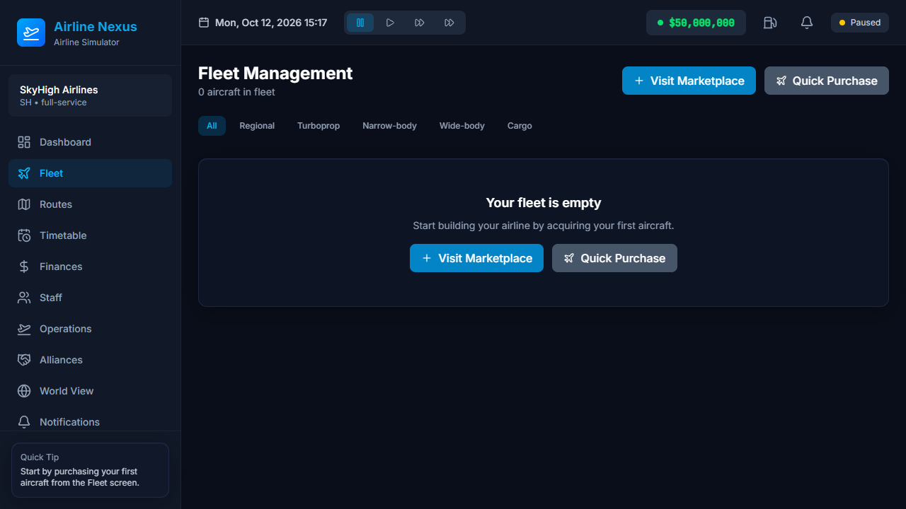
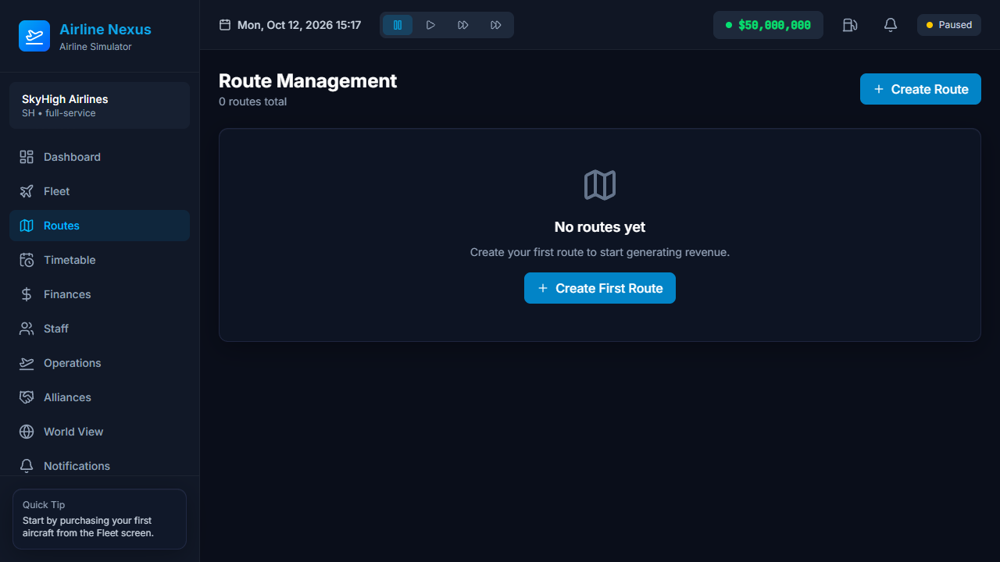

# Airline Nexus

An airline management simulation game. Build, operate, and expand your own airline empire using a realistic aviation economy with real-world airport data.

## Overview

Airline Nexus is a single-player management simulation in which the player assumes the role of an airline CEO. Starting from a small regional operation, the objective is to grow a global carrier through strategic decisions around fleet acquisition, route planning, staff recruitment, financial management, and business model selection.

The game models authentic aviation operations including fuel costs, landing fees, slot restrictions, aircraft maintenance, and crew scheduling regulations. Airport data is sourced from [OurAirports](https://ourairports.com).

## Screenshots

| | |
|---|---|
|  |  |
|  |  |
|  | |

Screenshots are captured automatically with Puppeteer — run `npm run screenshots` (requires `npm run build` first) to refresh `docs/screenshots/`.

## Features

| Feature | Description |
|---------|-------------|
| Fleet Management | 50+ aircraft types spanning regional turboprops to wide-body jumbo jets |
| Route Planning | Build a global network connecting real-world airports with authentic distances and time zones |
| Financial Strategy | Manage budgets, loans, revenue streams, and profitability across multiple business models |
| Staff Management | Hire, train, and assign pilots, cabin crew, and ground staff under realistic regulations |
| Realistic Operations | Fuel costs, maintenance schedules, landing fees, and slot restrictions |
| Business Models | Full-service, low-cost, and hybrid carrier strategies with distinct economics |
| Global Competition | Navigate market dynamics and compete against simulated carriers |
| 3D Visualization | Interactive globe with day/night cycle and flight-path rendering (Three.js) |

## Tech Stack

| Layer | Technology |
|-------|-----------|
| UI / Rendering | React 19, Three.js, React-Three-Fiber |
| State Management | Zustand (single game-state store) |
| Persistence | localStorage + IndexedDB (client-side only, no backend) |
| Styling | Tailwind CSS with a custom aviation color palette |
| Animation | Framer Motion |
| Build Tooling | Vite, TypeScript, PostCSS |
| 3D Shaders | GLSL (day/night earth shader) |
| Game Logic | Pure TypeScript engines (route, fleet, staff, finance, crew) |

## Getting Started

### Docker (recommended)

```bash
docker compose up
```

The game will be available at **http://localhost:4242**.

To override the port, create a `.env` file in the project root:

```bash
echo "AIRLINE_NEXUS_PORT=8080" > .env
docker compose up
```

### Development server

```bash
npm install
npm run dev
```

The Vite dev server starts at **http://localhost:4242**.

## How to Play

1. **Create Your Airline** — name your carrier, choose a home airport, and select a business model.
2. **Build Your Fleet** — purchase aircraft from the marketplace and assign them to routes.
3. **Expand Globally** — connect airports, adjust flight frequencies, and grow your network.
4. **Manage Finances** — balance revenue against operating costs, take loans, and invest strategically.
5. **Compete** — monitor market dynamics, position your airline, and aim for profitability.

## Project Structure

```
src/
├── main.tsx                  # Entry point — mounts App into the DOM
├── App.tsx                   # Top-level screen router
├── components/
│   ├── layout/               # UI shell (top bar, sidebar, notifications)
│   ├── screens/              # Game screens (fleet, routes, finances, staff, …)
│   ├── world/                # 3D globe and flight-path rendering
│   └── …                     # Modals, cards, charts, marketplace
├── store/
│   └── gameStore.ts          # Zustand state store (single source of truth)
├── types/
│   └── game.ts               # Shared type definitions (Airport, Aircraft, …)
├── utils/                    # Pure game-logic engines (route, fleet, staff, finance, crew)
├── data/                     # Static game data (aircraft types, airport database)
├── database/                 # localStorage / IndexedDB persistence layer
├── hooks/                    # React custom hooks (game loop, market timer)
├── shaders/                  # GLSL shaders for the earth renderer
└── styles/                   # Global and component CSS overrides
```

## Data Pipeline

The full airport database is sourced from [OurAirports](https://ourairports.com) (`world-airports.csv`, ~16 MB). A build-time script (`scripts/generate-airports.mjs`) parses the CSV and emits `src/data/airports-full.generated.ts`. A curated set of hub airports in `src/data/airports.ts` is merged at runtime (curated entries take precedence on IATA-code conflicts).

To regenerate the airport data:

```bash
npm run generate:airports
```

The generated file is committed to source control. The CSV is not needed at runtime and is excluded from the Docker build context.

## Configuration

| File | Purpose |
|------|---------|
| `vite.config.ts` | Build pipeline, path aliases, dev-server port |
| `tailwind.config.js` | Aviation color palette, font stacks, custom animations |
| `tsconfig.json` | TypeScript compiler options and path aliases |
| `nginx.conf` | Static file serving (Docker deployment) |
| `docker-compose.yml` | Home-lab deployment configuration |

## Development Commands

| Command | Description |
|---------|-------------|
| `npm run dev` | Start the Vite dev server (port 4242) |
| `npm run build` | Type-check and produce the static build (`dist/`) |
| `npm run lint` | Run ESLint over `src/` |
| `npm run test` | Run Vitest unit tests |
| `npm run generate:airports` | Regenerate the airport database from CSV |
| `npm run screenshots` | Capture the README screenshots with Puppeteer (requires `npm run build`) |

## Docker Deployment

The Docker image uses a multi-stage build:

1. **Build stage** (`node:20-slim`) — installs dependencies, runs `tsc && vite build`.
2. **Serve stage** (`nginx:alpine`) — serves the static output from `dist/`.

The final image contains only nginx and the static files. No Node.js runtime is needed at serve time.

```bash
docker compose up          # Build and start
docker compose up --build  # Rebuild from scratch
docker compose down        # Stop
```

## Requirements

- Modern browser with WebGL 2 support (Chrome, Firefox, Edge, Safari).
- No server-side backend or database is required. All game state is persisted client-side via localStorage and IndexedDB.
